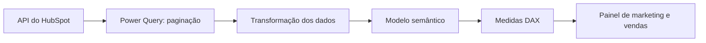

# Funil de marketing e vendas com Power BI e HubSpot

Case de Business Intelligence para acompanhar a jornada do lead: aquisição, qualificação, abordagem comercial, reuniões, propostas e fechamento.

**Power BI · Power Query / M · DAX · API REST · HubSpot**

## O problema

O time de marketing precisava acompanhar o avanço dos leads e o retorno comercial: quem foi contatado, quais oportunidades avançaram e por quais motivos outras foram perdidas.

O painel reúne essas informações em uma visão do funil, com detalhamento por período, origem, fonte e segmento.

## O que o painel acompanha

| Frente | Análises |
| --- | --- |
| Aquisição e qualificação | Leads, MQL e SQL |
| Retorno comercial | Contatados, não contatados e reuniões |
| Evolução das oportunidades | Diagnósticos, propostas e negociação |
| Resultado | Contratos fechados e valores comerciais |
| Perdas | Motivos de perda e pontos de atenção no funil |
| Histórico | Evolução por período e origem dos leads |

MQL significa lead qualificado pelo marketing; SQL significa lead qualificado para vendas. Os critérios de cálculo estão na documentação das medidas.

## Visão técnica



A integração histórica usa funções em M para percorrer páginas da API e obter os dados de contatos. O relatório também acompanha negócios e a conversão em clientes, conforme o briefing do autor.

O inventário do projeto de referência identificou **16 páginas, 203 medidas e 37 relacionamentos**. Esta edição apresenta nove medidas cujos nomes aparecem nas definições do relatório.

## Exemplos técnicos em destaque

### DAX: quantidade de MQL por data de qualificação

Esta medida do projeto conta contatos distintos com data de MQL preenchida e utiliza essa data no relacionamento com o calendário.

```dax
MQL =
CALCULATE(
    CALCULATE(
        DISTINCTCOUNT(hs_Contatos_Hub[Contact ID]),
        hs_Contatos_Hub[Data que virou MQL] <> BLANK(),
        USERELATIONSHIP(
            hs_Contatos_Hub[Data que virou MQL],
            dCalendario[Date]
        )
    ) + 0
)
```

A leitura por período depende dos filtros e relacionamentos do modelo. Este exemplo exige as tabelas e colunas referenciadas.

### Power Query: obtenção de contatos com paginação

A integração histórica utilizava funções para descobrir a próxima página e obter seus dados. Uma lista de deslocamentos orientava as consultas, que alimentavam a transformação e o modelo.

Veja o [fluxo interno e o passo a passo da conexão histórica](docs/integracao.md), incluindo requisição ao HubSpot, função de próxima página, `List.Generate` e aplicação da função. O endpoint legado está identificado como descontinuado; os exemplos não representam uma conexão atual validada.

Consulte também a [função demonstrativa sem conexão](power-query/fxPaginarContatos.m). O exemplo público utiliza dados fictícios, sem API ou credenciais, e ilustra a paginação sem expor a integração completa.

## Telas

As capturas para publicação serão adicionadas em [assets/screenshots](assets/screenshots/README.md), após a substituição de marca e informações comerciais por uma apresentação apropriada ao portfólio.

## Explore o projeto

- [Contexto, escopo e decisões](docs/projeto.md)
- [Integração histórica com o HubSpot](docs/integracao.md)
- [Principais medidas e regras de cálculo](docs/medidas-dax.md)
- [Código DAX selecionado](dax/medidas-funil.dax)
- [Função demonstrativa em Power Query](power-query/fxPaginarContatos.m)
- [Demonstração com páginas fictícias](power-query/demo-paginacao.m)
- [Histórico de alterações](CHANGELOG.md)

## Sobre esta edição

Este repositório é um estudo de caso documental. Contém explicações e exemplos DAX extraídos do projeto, com identificador de pipeline substituído por um marcador. Os exemplos dependem do modelo original e não são um relatório executável independente.

Não são distribuídos dados reais, credenciais, conexões, cache ou o PBIP original. Segundo o autor, o painel histórico foi descontinuado em 2025 e acompanha informações desde 2021. A extração atual da API e a execução dos cálculos não foram revalidadas nesta edição.

## Minha participação

Desenvolvimento da integração de contatos com o HubSpot em Power Query, utilizando funções para paginação e obtenção das respostas da API. Os demais detalhes de participação serão complementados conforme a revisão do case.

## Como consultar

Leia o contexto, consulte as regras das medidas e abra o arquivo .dax como texto. Não é necessário configurar autenticação ou acessar o HubSpot para consultar este material.

O código é publicado para consulta técnica. Esta edição não concede uma licença de reutilização; a definição de licença fica para uma etapa posterior.
