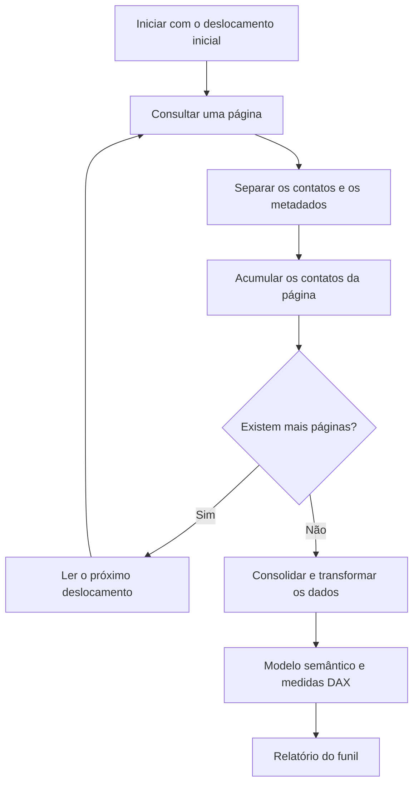

# Integração e paginação em Power Query

## Como a integração foi construída

A extração histórica de contatos do HubSpot foi organizada em funções em linguagem M:

- Uma função consultava a resposta da API para obter o próximo deslocamento de paginação.
- Outra função obtinha os dados de contatos da página solicitada.
- A consulta principal utilizava `List.Generate` para percorrer os deslocamentos e alimentar o tratamento dos dados.

A autenticação era enviada no cabeçalho da requisição. Credenciais, identificadores internos e o mapeamento completo das propriedades não são publicados.

## Fluxo interno de extração

O diagrama descreve o fluxo lógico de paginação e consolidação, sem reproduzir toda a implementação histórica.



## O que é paginação

A API devolve os registros em blocos, chamados páginas. Para obter o conjunto completo, a consulta precisa pedir os blocos seguintes até a resposta indicar que não há mais páginas.

No padrão histórico apresentado, `has-more` informa se existe uma próxima página; `vid-offset` informa o deslocamento para a próxima consulta. Esse deslocamento funciona como uma referência de continuação, e não necessariamente como o número da página.

`List.Generate` repete a obtenção das páginas. A etapa de consolidação reúne os contatos retornados para depois transformá-los em tabela.

Paginação e atualização incremental são conceitos diferentes: paginação percorre blocos de uma resposta; atualização incremental restringe a atualização a determinadas faixas de dados.

## Implementação histórica: conexão, função e aplicação

Os trechos abaixo demonstram o padrão de paginação que utilizei, com parâmetros genéricos. O endereço público do HubSpot foi mantido; lista, token, propriedades específicas e regras internas não são fornecidos.

**Contexto de versão:** o endpoint `/contacts/v1/lists/{list_id}/contacts/all` pertence à Contact Lists API v1. A HubSpot anunciou a retirada dos endpoints de listas v1, com exceções que não incluem este endpoint de lista específica, em **30 de abril de 2026**. Portanto, estes trechos documentam a construção histórica e não devem ser usados como instrução de conexão atual. Veja o [comunicado oficial da HubSpot](https://developers.hubspot.com/changelog/extension-contact-lists-api-v1-sunset-moved-to-april-30-2026). Uma retomada exige migração para a API vigente.

### 1. Parâmetros e conexão

No projeto real, a consulta recebia autenticação e configuração da fonte. Nesta versão, `pListaId` e `pTokenHubSpot` representam parâmetros de texto não distribuídos. Não coloque valores reais no repositório. A referência ao token ilustra o cabeçalho histórico; não é uma recomendação de armazenamento de segredos em arquivos M.

A função `fxnexDados` recebe um deslocamento, monta a requisição e retorna um registro M obtido do JSON.

```powerquery
// Reprodução didática do padrão histórico. Endpoint de lista v1 descontinuado.
// Parâmetros de texto esperados: pListaId e pTokenHubSpot.
// Nenhum valor real desses parâmetros é distribuído.
(vidOffset as text) as record =>
let
    Resposta = Json.Document(
        Web.Contents(
            "https://api.hubapi.com",
            [
                RelativePath = "contacts/v1/lists/" & pListaId & "/contacts/all",
                Query = [
                    count = "100",
                    propertyMode = "value_and_history",
                    vidOffset = vidOffset
                ],
                Headers = [
                    Authorization = "Bearer " & pTokenHubSpot
                ]
            ]
        )
    )
in
    Resposta
```

`Web.Contents` faz a requisição; `RelativePath` compõe o caminho; `Query` fornece os parâmetros; `Json.Document` interpreta a resposta. Foi usado um tamanho ilustrativo de 100 registros por página, sem afirmar que esse era o tamanho original.

Arquivo: [historico/fxnexDados.m](../power-query/historico/fxnexDados.m).

### 2. Função de próxima página

A função `fxnextPage` consulta os metadados da resposta. Havendo mais registros, retorna o próximo deslocamento; caso contrário, retorna `null`.

```powerquery
// Função histórica adaptada: null representa o fim da paginação.
(vidOffset as text) as nullable text =>
let
    Resposta = fxnexDados(vidOffset),
    ProximoDeslocamento =
        if Resposta[#"has-more"] then
            Text.From(Resposta[#"vid-offset"])
        else
            null
in
    ProximoDeslocamento
```

Arquivo: [historico/fxnextPage.m](../power-query/historico/fxnextPage.m).

### 3. List.Generate e aplicação da função

A consulta `Contatos` gera os deslocamentos e os transforma em tabela. Em seguida, **Adicionar coluna → Invocar função personalizada** corresponde à etapa `Table.AddColumn`: para cada deslocamento, aplica `fxnexDados`.

```powerquery
// Consulta histórica adaptada. Depende de fxnextPage e fxnexDados.
// Não executar contra a API atual: o endpoint de listas v1 foi descontinuado.
let
    Deslocamentos = List.Generate(
        () => "0",
        each _ <> null,
        each fxnextPage(_)
    ),
    TabelaDeslocamentos = Table.FromList(
        Deslocamentos,
        Splitter.SplitByNothing(),
        {"Deslocamento"}
    ),
    FuncaoAplicada = Table.AddColumn(
        TabelaDeslocamentos,
        "Resposta",
        each fxnexDados([Deslocamento]),
        type record
    ),
    ListasContatos = List.Transform(
        FuncaoAplicada[Resposta],
        each Record.Field(_, "contacts")
    ),
    ContatosConsolidados = List.Combine(ListasContatos),
    Resultado = Table.FromRecords(ContatosConsolidados)
in
    Resultado
```

Arquivo: [historico/Contatos.m](../power-query/historico/Contatos.m).

### 4. Leitura das etapas

| Etapa | Entrada | Saída |
| --- | --- | --- |
| Deslocamentos | Deslocamento inicial e função de paginação | Lista de referências de continuação |
| TabelaDeslocamentos | Lista de referências | Uma linha por deslocamento |
| FuncaoAplicada | Cada linha da tabela | Registro JSON interpretado de cada página |
| ListasContatos | Respostas das páginas | Listas do campo contacts |
| ContatosConsolidados | Listas das páginas | Uma lista reunindo os contatos |
| Resultado | Lista de contatos | Tabela para transformação posterior |

A tabela final conserva campos estruturados, como propriedades em registros, quando presentes. A expansão desses campos e as regras específicas do negócio permanecem reservadas.

### O que foi adaptado

- No trecho original apresentado, a função de paginação repetia a requisição. Aqui ela reutiliza `fxnexDados` para centralizar a construção da conexão.
- O trecho original iniciava a lista com `"1"` e usava `"0"` para encerrar. O exemplo adaptado começa com `"0"` e usa `null` para encerrar, separando o deslocamento inicial do sinal de término.
- A consulta original enviada estava incompleta. As etapas de aplicação e consolidação acima são uma reconstrução didática, e não uma transcrição validada do projeto completo.
- Esse padrão pode consultar uma página tanto para descobrir a próxima referência quanto para obter seus dados. Não há promessa de uma única requisição por página. O exemplo demonstrativo anterior mostra como percorrer diretamente as respostas.
- Os trechos históricos não foram executados contra o HubSpot; a demonstração com dados fictícios continua sendo a alternativa para experimentar o conceito sem conexão.

## Exemplo público em Power Query

A função [fxPaginarContatos.m](../power-query/fxPaginarContatos.m) é uma adaptação didática criada para este portfólio. Ela recebe uma função de obtenção da página como parâmetro, percorre as respostas e retorna uma lista consolidada.

Essa adaptação reúne dados e metadados de cada resposta em um único percurso. Ela ilustra o conceito; não é uma reprodução literal das funções históricas. A última página é incluída antes do encerramento.

### Entrada → processamento → saída

- **Entrada:** uma função que fornece páginas e um deslocamento inicial.
- **Processamento:** leitura de `contacts`, verificação de `has-more` e avanço por `vid-offset`.
- **Saída:** lista de contatos das páginas percorridas.

```powerquery
// Exemplo didático adaptado; não contém a integração original nem chamadas de rede.
// ObterPagina recebe um deslocamento e devolve contacts, has-more e vid-offset.
(ObterPagina as function, DeslocamentoInicial as text) as list =>
let
    Paginas = List.Generate(
        () => ObterPagina(DeslocamentoInicial),
        each _ <> null,
        each
            if [#"has-more"] then
                ObterPagina(Text.From([#"vid-offset"]))
            else
                null,
        each [contacts]
    ),
    Contatos = List.Combine(Paginas)
in
    Contatos
```

## Como experimentar sem conectar uma API

1. No Editor do Power Query do Power BI Desktop, crie uma **Consulta Nula**.
2. Abra o **Editor Avançado**, cole o conteúdo de `fxPaginarContatos.m` e nomeie a consulta como `fxPaginarContatos`.
3. Crie outra Consulta Nula e cole o conteúdo de [demo-paginacao.m](../power-query/demo-paginacao.m).
4. Confira o resultado esperado: uma tabela com cinco contatos fictícios, de Contato A a Contato E, obtidos de três páginas.

A demonstração não acessa a internet nem precisa de credenciais. O exemplo foi revisado textualmente, mas ainda não foi executado no Power BI Desktop.

## Escopo desta publicação

A implementação completa permanece reservada. A demonstração pressupõe respostas com os campos descritos e deslocamentos válidos; não inclui autenticação, tratamento de falhas ou limites de requisições. Esses comportamentos e a compatibilidade atual da API devem ser avaliados antes de qualquer uso real.
