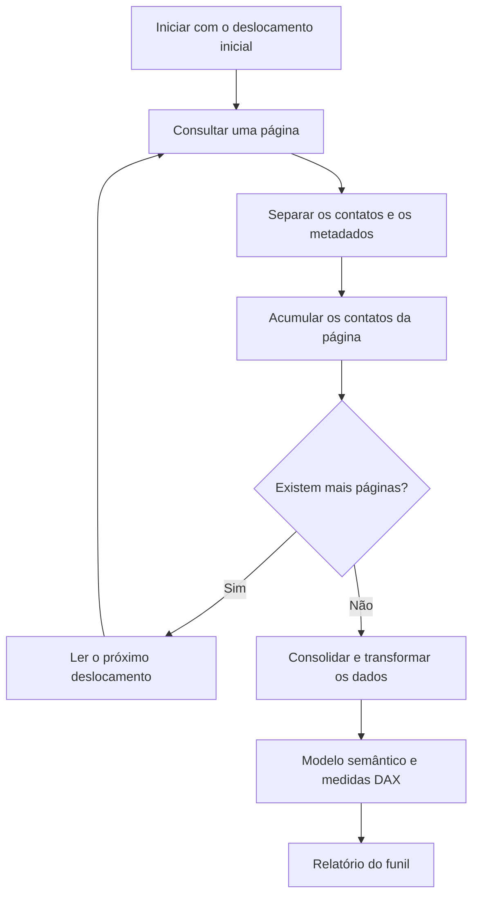

# Integração e paginação em Power Query

## Como a integração foi construída

A extração histórica de contatos do HubSpot foi organizada em funções em linguagem M:

- Uma função consultava a resposta da API para obter o próximo deslocamento de paginação.
- Outra função obtinha os dados de contatos da página solicitada.
- A consulta principal utilizava `List.Generate` para percorrer os deslocamentos e alimentar o tratamento dos dados.

A autenticação era enviada no cabeçalho da requisição. Credenciais, identificadores internos e o mapeamento completo das propriedades não são publicados.

## Fluxo interno de extração

O diagrama descreve o fluxo lógico de paginação e consolidação, sem reproduzir toda a implementação histórica.



## O que é paginação

A API devolve os registros em blocos, chamados páginas. Para obter o conjunto completo, a consulta precisa pedir os blocos seguintes até a resposta indicar que não há mais páginas.

No padrão histórico apresentado, `has-more` informa se existe uma próxima página; `vid-offset` informa o deslocamento para a próxima consulta. Esse deslocamento funciona como uma referência de continuação, e não necessariamente como o número da página.

`List.Generate` repete a obtenção das páginas. A etapa de consolidação reúne os contatos retornados para depois transformá-los em tabela.

Paginação e atualização incremental são conceitos diferentes: paginação percorre blocos de uma resposta; atualização incremental restringe a atualização a determinadas faixas de dados.

## Exemplo público em Power Query

A função [fxPaginarContatos.m](../power-query/fxPaginarContatos.m) é uma adaptação didática criada para este portfólio. Ela recebe uma função de obtenção da página como parâmetro, percorre as respostas e retorna uma lista consolidada.

Essa adaptação reúne dados e metadados de cada resposta em um único percurso. Ela ilustra o conceito; não é uma reprodução literal das funções históricas. A última página é incluída antes do encerramento.

### Entrada → processamento → saída

- **Entrada:** uma função que fornece páginas e um deslocamento inicial.
- **Processamento:** leitura de `contacts`, verificação de `has-more` e avanço por `vid-offset`.
- **Saída:** lista de contatos das páginas percorridas.

```powerquery
// Exemplo didático adaptado; não contém a integração original nem chamadas de rede.
// ObterPagina recebe um deslocamento e devolve contacts, has-more e vid-offset.
(ObterPagina as function, DeslocamentoInicial as text) as list =>
let
    Paginas = List.Generate(
        () => ObterPagina(DeslocamentoInicial),
        each _ <> null,
        each
            if [#"has-more"] then
                ObterPagina(Text.From([#"vid-offset"]))
            else
                null,
        each [contacts]
    ),
    Contatos = List.Combine(Paginas)
in
    Contatos
```

## Como experimentar sem conectar uma API

1. No Editor do Power Query do Power BI Desktop, crie uma **Consulta Nula**.
2. Abra o **Editor Avançado**, cole o conteúdo de `fxPaginarContatos.m` e nomeie a consulta como `fxPaginarContatos`.
3. Crie outra Consulta Nula e cole o conteúdo de [demo-paginacao.m](../power-query/demo-paginacao.m).
4. Confira o resultado esperado: uma tabela com cinco contatos fictícios, de Contato A a Contato E, obtidos de três páginas.

A demonstração não acessa a internet nem precisa de credenciais. O exemplo foi revisado textualmente, mas ainda não foi executado no Power BI Desktop.

## Escopo desta publicação

A implementação completa permanece reservada. A demonstração pressupõe respostas com os campos descritos e deslocamentos válidos; não inclui autenticação, tratamento de falhas ou limites de requisições. Esses comportamentos e a compatibilidade atual da API devem ser avaliados antes de qualquer uso real.
